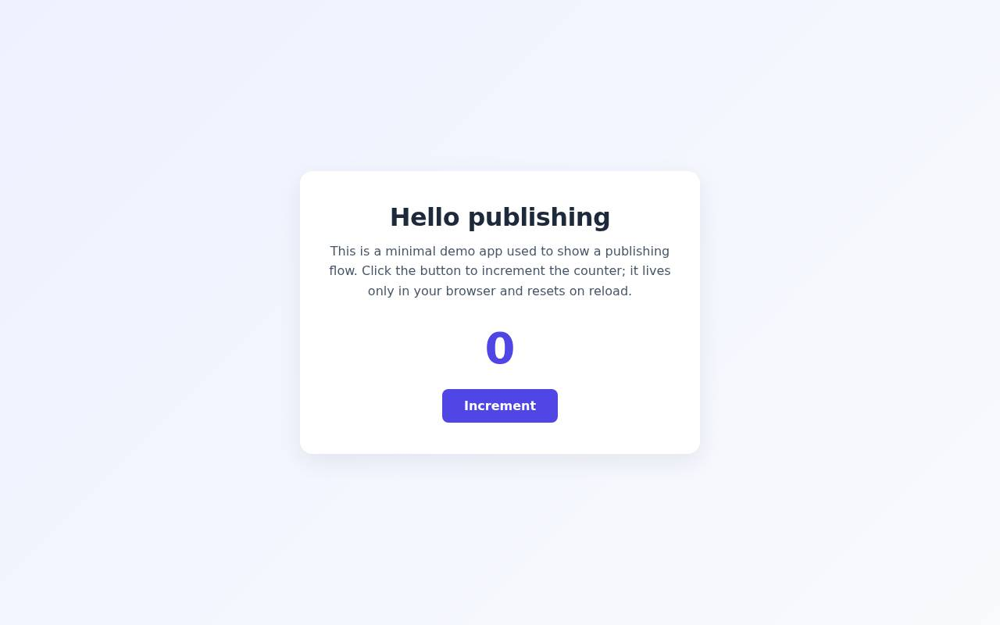
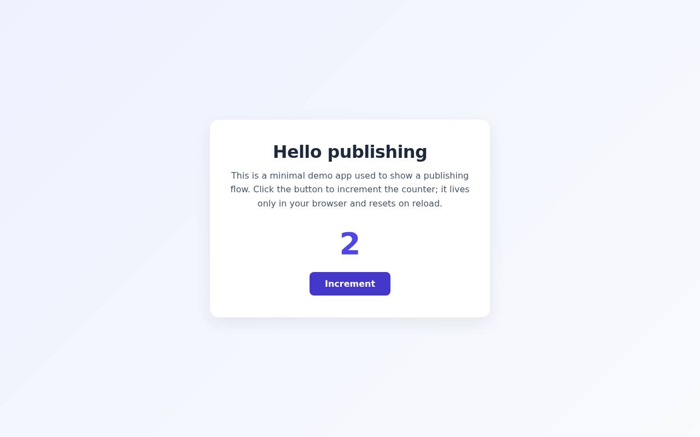

# How to run Hello publishing

## 1. Run locally

Requires Node.js 22 or newer. No install step is needed (there are no dependencies).

Run `npm start` from the **source directory**, which contains `package.json` and `server.js`. If you're viewing the made-with-marsl release folder, change into `src/` first:

```sh
cd src        # only when starting from the made-with-marsl release folder
npm start
```

Expected output:

```text
> hello-publishing@1.0.0 start
> node server.js

Hello publishing listening on http://0.0.0.0:3000
```

## 2. Check that it responds

In a second terminal:

```sh
curl -s localhost:3000/health
curl -s -o /dev/null -w '%{http_code}\n' localhost:3000/does-not-exist
```

Expected output:

```text
{"ok":true}
404
```

## 3. Use the page

Open http://localhost:3000. You should see the heading, a short explanation and a counter at 0:



*Step 3: the page right after loading.*

Click **Increment** twice. The counter now shows 2:



*Step 3, continued: the counter after two clicks.*

The count lives only in the browser. **Reloading the page resets it to 0.**

Stop the server with `Ctrl+C`. It prints `Received SIGINT, shutting down` and exits.

## 4. Use a different port

Stop the first server, then start it again on port 4000 from the source directory (`src/` in the release folder):

```sh
PORT=4000 npm start
```

The server prints `Hello publishing listening on http://0.0.0.0:4000` and keeps running. In a **second terminal**, run:

```sh
curl -s localhost:4000/health
```

Expected output:

```text
{"ok":true}
```

## 5. Run with Docker

Pick the build command for the directory you're in.

**Collection release, from the made-with-marsl release folder** (the folder that contains `Dockerfile` and `src/`). This uses the release `Dockerfile` with `src` as the build context, so you build the packaged release that includes the documentation:

```sh
docker build -f Dockerfile -t hello-publishing src
```

**Standalone source, from the source directory** (the folder that contains `Dockerfile`, `package.json` and `server.js`):

```sh
docker build -t hello-publishing .
```

Run the image from any directory:

```sh
docker run --rm -p 3000:3000 hello-publishing
```

Expected output:

```text
> hello-publishing@1.0.0 start
> node server.js

Hello publishing listening on http://0.0.0.0:3000
```

The image is based on `node:22-alpine`, runs as the unprivileged `node` user and exposes port 3000. To use another port inside the container, pass `-e PORT=8080 -p 8080:8080`.

## Troubleshooting

- **`EADDRINUSE: address already in use 0.0.0.0:3000`**: another process is using port 3000. Stop that process or run `PORT=3001 npm start`.
- **`curl: (7) Failed to connect`**: check that the server is still running and that you're using the port from its startup line.
- **`404 Not Found`**: only `/` and `/health` exist. Check the path.
- **`405 Method Not Allowed`**: only `GET` and `HEAD` are supported.
- **The counter went back to 0**: this is expected after a reload. The count isn't stored.
- **Syntax or engine errors on start**: check `node -v`. You need Node.js 22 or newer.
- **`npm error enoent Could not read package.json`**: you're in the wrong directory. Run `npm start` from the source directory (`src/` in the release folder).
- **Docker `COPY failed` / `package.json: not found`**: the build context is wrong. From the release folder, use `docker build -f Dockerfile -t hello-publishing src`. From the source directory, use `docker build -t hello-publishing .`.
- **Docker can't reach the app**: make sure you published the port (`-p 3000:3000`). The server already binds to `0.0.0.0`.
