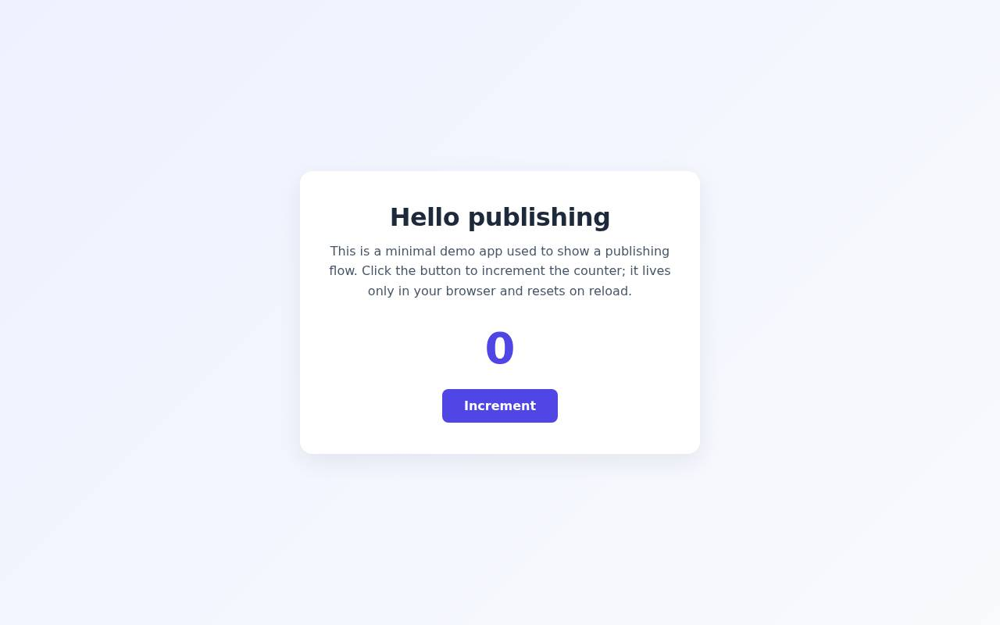

# Hello publishing

A tiny, dependency-free Node.js web app used to demo a publishing flow. It serves one page with a heading, a short explanation and an **Increment** button that updates a visible counter, plus a `/health` endpoint for health checks.



*The page as served at `http://localhost:3000/`. The counter starts at 0.*

## Requirements

- Node.js 22 or newer (`engines.node` is `>=22`)
- No npm dependencies, database or external services

## Setup

Run all `npm` commands from the **source directory**, which is the folder that contains `package.json` and `server.js`. In the made-with-marsl release folder, that folder is `src/`:

```sh
cd src        # only when starting from the made-with-marsl release folder
npm start
```

You don't need `npm install` because the app only uses Node built-ins. Running it is harmless.

## Configuration

| Variable | Default | Purpose |
| --- | --- | --- |
| `PORT` | `3000` | TCP port to listen on. The server always binds to `0.0.0.0`. |

**Required credentials:** none. The app needs no API keys, tokens or secrets.

## Endpoints

- `GET /` (and `HEAD`): the demo page (`text/html; charset=utf-8`)
- `GET /health` (and `HEAD`): returns `200` with `application/json` body `{"ok":true}`
- Any other path returns `404 Not Found` (plain text). Other methods on `/` or `/health` return `405 Method Not Allowed` with an `Allow` header.

## Example

In the source directory (`src/` in the release folder), start the server on port 4000:

```sh
PORT=4000 npm start
```

In a second terminal, while the server keeps running in the first one, run:

```sh
curl -s localhost:4000/health
```

Expected output:

```text
Hello publishing listening on http://0.0.0.0:4000   # server terminal
{"ok":true}                                         # curl terminal
```

Open `http://localhost:4000/` and click **Increment** twice. The counter shows 2:


*After two clicks on Increment, the counter reads 2. Reloading the page resets it to 0.*

## Docker

Docker commands depend on which directory you run them from:

- **From the made-with-marsl release folder** (the folder that contains `Dockerfile` and `src/`), build the collection release with the packaged documentation:

  ```sh
  docker build -f Dockerfile -t hello-publishing src
  ```

- **From the source directory** (standalone source, which contains `Dockerfile`, `package.json` and `server.js`):

  ```sh
  docker build -t hello-publishing .
  ```

Run the image the same way in both cases:

```sh
docker run --rm -p 3000:3000 hello-publishing
```

See [HOWTO.md](HOWTO.md) for step-by-step instructions, Docker usage and troubleshooting.

## Limitations

- The counter is client-side only. It isn't saved anywhere, is not shared between tabs or visitors, and **resets to 0 on reload**.
- There is no server state, database, authentication or persistence. The app is intended as a demo only.
- The server sends no caching, security or compression headers.

## License

MIT. See [LICENSE](LICENSE). Copyright (c) 2026 Hello publishing contributors.
