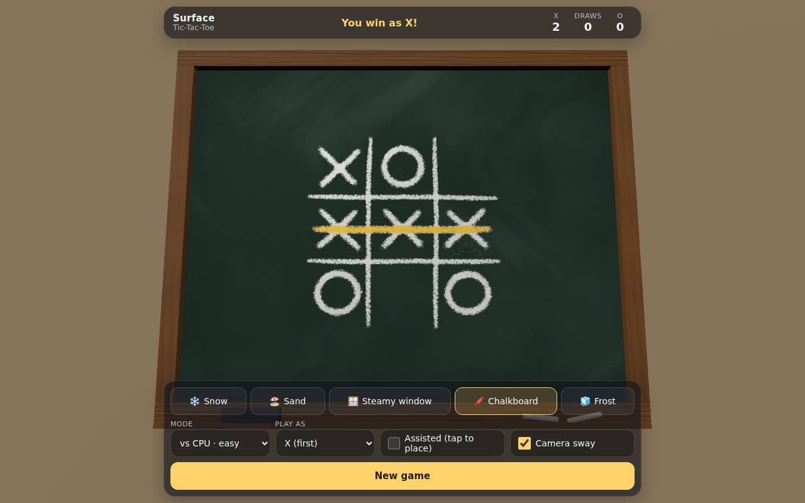
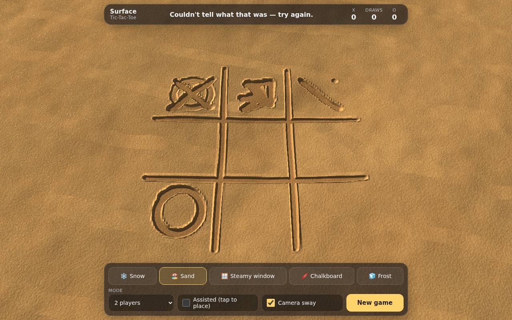
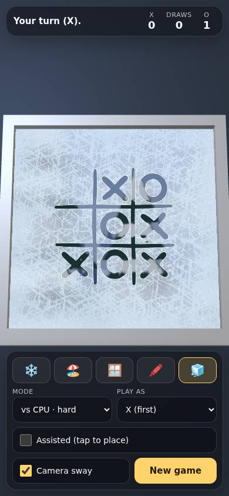

# How to run and play Surface Tic-Tac-Toe

This walkthrough takes you from a fresh checkout to a finished game, and shows what to expect at each step.
You don't need credentials, environment variables or a database.

## 1. Install, test and build

```bash
npm ci
npm test
npm run build
```

Expected output (abridged; asset hashes and timings will differ):

```text
 ✓ src/game/game.test.ts (23 tests)
 ✓ src/gesture/recognize.test.ts (45 tests)
 ✓ src/gesture/rules.test.ts (4 tests)
 ✓ src/render/feel.test.ts (3 tests)

 Test Files  4 passed (4)
      Tests  75 passed (75)

dist/index.html                   2.73 kB │ gzip:   1.14 kB
dist/assets/index-XxOcUqG4.css    4.06 kB │ gzip:   1.46 kB
dist/assets/index-V9JUW3Uk.js   604.99 kB │ gzip: 157.21 kB
✓ built in 510ms
```

## 2. Serve the built site and check health

```bash
npm run preview -- --port 4173
# in another terminal:
curl http://localhost:4173/health
```

Expected output of `curl`:

```text
ok
```

Use `npm run dev` for development instead (hot reload at http://localhost:5173). With Docker, run
`docker build -t surface-tic-tac-toe . && docker run --rm -p 8080:8080 surface-tic-tac-toe` and use port 8080.

## 3. Play a game by drawing

1. Open http://localhost:4173/#chalkboard. The status bar says **"Your turn (X)."** and a hint reads
   **"Draw an X or O in a square"**.
2. Press and drag inside the centre square to draw one diagonal line, then draw a second diagonal that crosses it.
   The chalk appears under your pointer as you draw.
3. Lift your finger and wait a moment. The X stays on the board, the status changes to
   **"Computer is thinking (O)…"**, and the computer draws its O.
4. Keep going until someone has three in a row. A yellow line is drawn through the winning row, the status shows
   the result (for example **"You win as X!"**), and the score at the top right goes up.


*Expected result after a win: the winning line is drawn into the surface and the score updates.*

Press **New game** to play again. Pick another surface at the bottom to start a new game there. The score
lasts until you reload the page.

### What a rejected drawing looks like

If you draw the wrong symbol, a scribble or a shape across two squares, the ink stays briefly, then fades
out, and the status explains why:

| You draw | Message |
|---|---|
| An O when it's X's turn | "It's X's turn — draw an X." |
| Something that isn't an X or O | "Couldn't tell what that was — try again." |
| In an occupied square | e.g. "Top left is taken" |


*A scribble is rejected. Its grooves in the sand fade out about 2 seconds later, and the turn stays with the same player.*

## 4. Try every surface and mode

- Surfaces: `#snow`, `#sand`, `#steam`, `#chalkboard`, `#frost` (or use the buttons).
- Modes: *2 players* (pass the device), *vs CPU · easy* (random) and *vs CPU · hard* (never loses).
  As **O** in vs-CPU mode, the computer opens with X.
- No drawing? Turn on **Assisted (tap to place)** and tap a square, or use the keyboard: Tab to the board,
  arrow keys to move, Enter or Space to play.

On a phone, the controls stack under the board:


*Frost at a 390 px wide viewport. Strokes melt clear lines through the ice.*

## 5. Hands-free demo

Open http://localhost:4173/?demo=draw&mode=hard#steam to watch both sides draw their moves through the real
pointer and recognition pipeline. Add `&mistakes` to include deliberately wrong drawings, or use `?demo` for
quick random moves with generated strokes.

## Troubleshooting

| Problem | Fix |
|---|---|
| Blank page or "This game needs JavaScript and WebGL." | Enable JavaScript and hardware acceleration in your browser, then check that WebGL works at https://get.webgl.org. |
| `npm ci` fails with an engine or syntax error | Use Node.js 20.19+ or 22.12+ (`node -v`). |
| `npm ci` complains that the lockfile is out of sync | Don't edit `package.json` without running `npm install` to update `package-lock.json`. |
| `getaddrinfo ENOTFOUND localhost` when starting the server | Your system can't resolve `localhost`. Bind to an IP instead: `npm run preview -- --host 127.0.0.1`. |
| `Port 4173 is already in use` | Stop the other process, or run `npm run preview -- --port 4180`. |
| My X is rejected | Draw two fairly straight lines that cross near their middles at roughly 45°, both inside one square, and start the second line within about 0.85 s of finishing the first. A "+" doesn't count. |
| My O is rejected | Draw one loop that comes back close to its start and isn't much wider than tall. Very small marks (under about a quarter of a square) are ignored. |
| Tapping does nothing | That's expected unless **Assisted (tap to place)** is on. Otherwise, draw the shape. |
| Nothing happens while the computer plays | Input is paused during the CPU's turn and stroke animations. Wait for "Your turn". |
| The board moving with the mouse is distracting | Turn off **Camera sway**. The setting is remembered. Reduced-motion system settings turn it off too. |
| Docker container is unhealthy | Check `curl localhost:8080/health`. If you set `PORT`, publish the same port (`-e PORT=9000 -p 9000:9000`). |
| Dev server rejects a custom hostname | Vite only allows known hosts. Add yours to `server.allowedHosts` in `vite.config.ts` (keep `.preview.marsl.dev` if you deploy to MARSL previews). |
