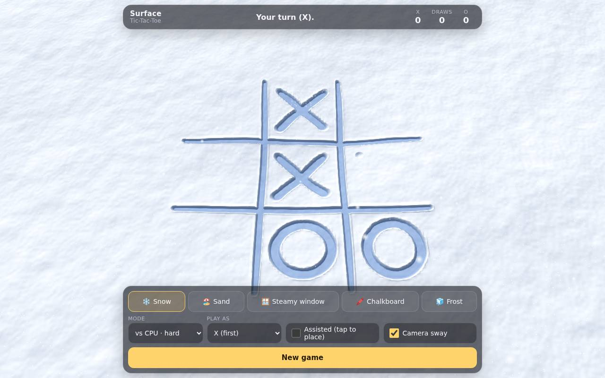
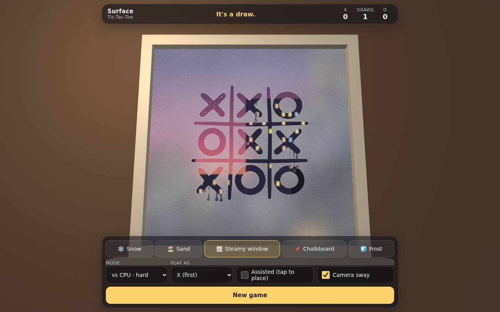
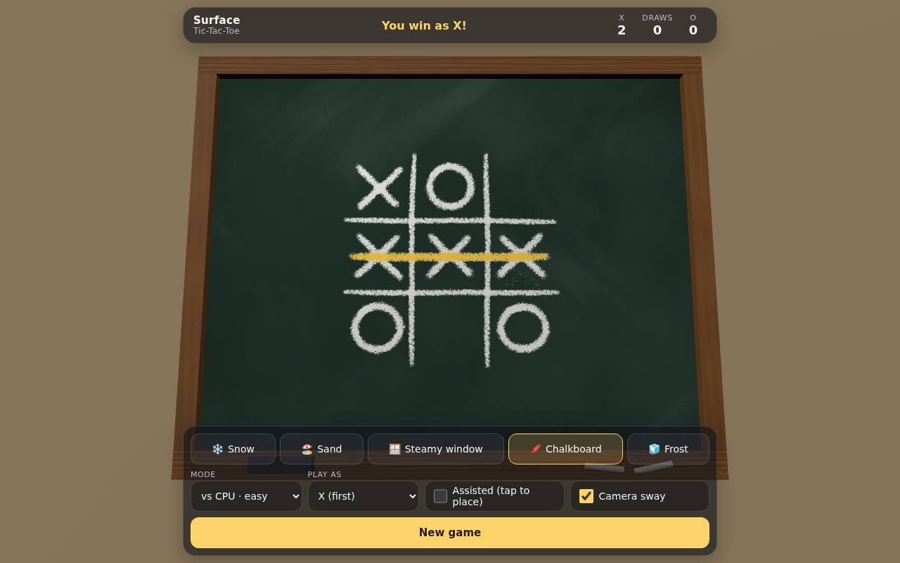
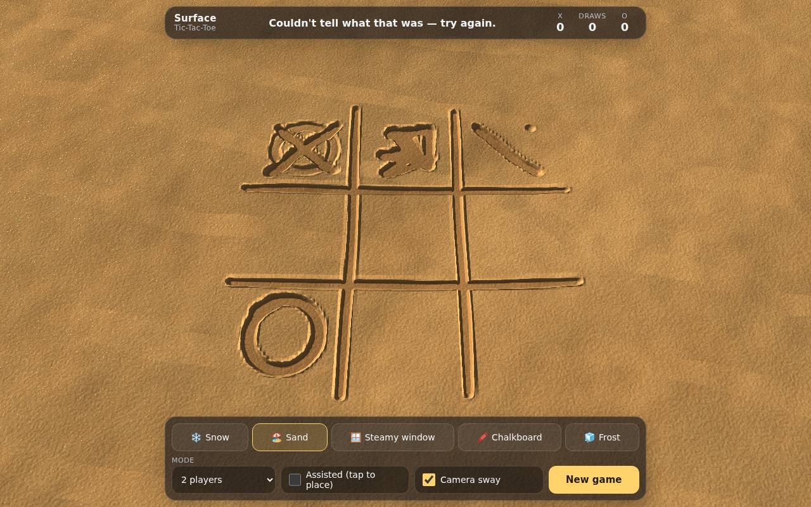

# tic-tac-toe

Tic Tac Toe

## In use









Published by Raphael Terrier with MARSL.

## Run this release

```sh
docker pull ghcr.io/render-lab/marsl-tic-tac-toe-5b8d8cb1-6b9d-4115-bd94-7ac58e1dec24:1.0.0
```

Follow [the how-to](HOWTO.md) for runtime arguments, ports, configuration, and expected output. Supply your own credentials at runtime.

## Included

- [Project README](src/README.md)
- [Step-by-step how-to](HOWTO.md)
- [Source](src/) and [container build recipe](Dockerfile)
- [License](LICENSE)

## Build it yourself

From this release directory:

```sh
docker build -f Dockerfile -t ghcr.io/render-lab/marsl-tic-tac-toe-5b8d8cb1-6b9d-4115-bd94-7ac58e1dec24:1.0.0 src
```

Documentation is included in the image at /usr/share/doc/marsl/.

## Version and evidence

Version: 1.0.0

Source digest: `549bc0dddad3221cccbf2fd0f4f381b2cb4384cc44bfaae53321f26be3e5e2ed`

The selected source built and started in a MARSL preview. That does not verify this container or every instruction. GitHub builds the container after internal review; inspect the linked build results and the project documentation for additional evidence.
