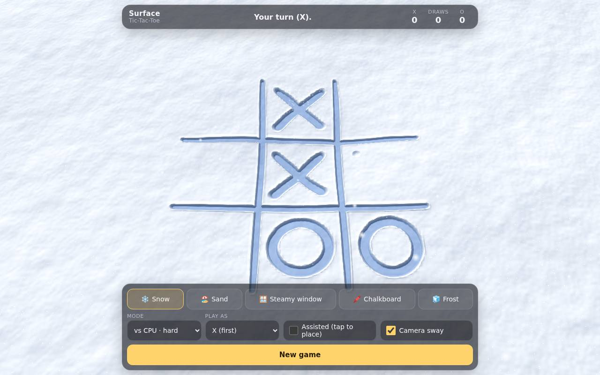
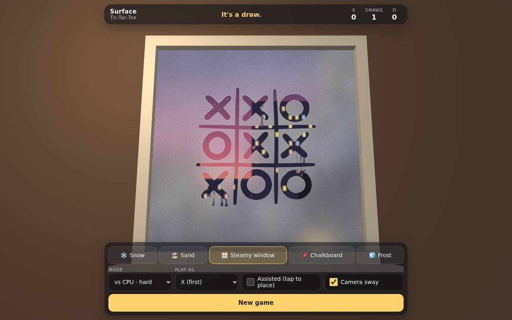
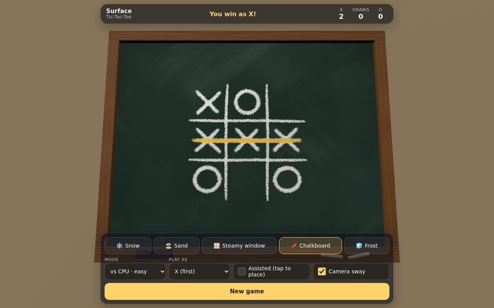
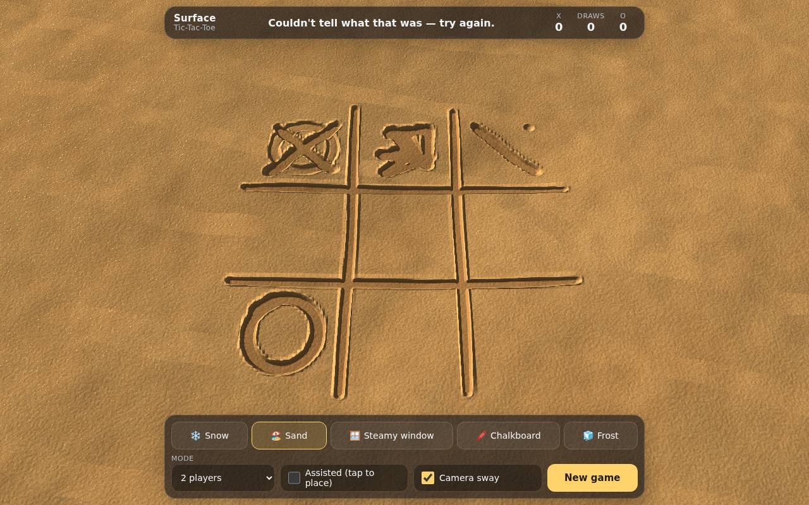

# Surface Tic-Tac-Toe

Tic-tac-toe that you **draw with your finger** (or a mouse or pen) into different surfaces, rendered with
[Three.js](https://threejs.org): **snow**, **sand**, a **steamy window**, a **chalkboard** and **frost** on glass.
Draw an X or an O in a square. The game recognizes the shape, works out which square you meant, and keeps your
own strokes in the surface. All textures are procedural (canvas and GLSL), so the game ships no image assets.
It is a static site with no backend.


*Snow: each mark is pressed into the snow as a groove. The bottom panel switches surfaces and sets the game options.*

## Features

- Local 2-player (hot-seat) or vs computer: *easy* plays randomly, *hard* uses minimax and can't be beaten.
- Pick X or O; X always moves first.
- **Draw your move** with a finger, pen or mouse: an X (two crossing lines) or an O (one loop) inside a square.
  The ink appears live in the surface. If the drawing is recognized as your symbol in a free square, the move is
  played and your actual strokes stay. Otherwise the ink fades away with a short message, e.g. "It's X's turn — draw an X."
- **Assisted (tap to place)** in the settings: tap a square to place the current symbol with generated strokes
  (off by default; when it is off, taps only show the drawing hint).
- Keyboard: Tab to the board, arrow keys to move, Enter or Space to play (generated strokes). Moves, results and
  rejected drawings are announced through an ARIA live region.
- The score lasts for the session (in memory). Switching surfaces starts a new game.
- `prefers-reduced-motion` shortens the animations and turns off particles, droplets and camera sway.
- **Camera sway**: the camera drifts slightly with the mouse (small dead zone, soft curve, slow easing; touch and
  pen are ignored). Turn it off with the "Camera sway" toggle in the HUD (remembered in localStorage).
- Responsive layout for phones and touch screens.

| | |
|---|---|
|  |  |
| *Steamy window: strokes wipe the fog and condensation runs down. This game ended in a draw.* | *Chalkboard: the winning row gets a yellow chalk line, and the score updates.* |

## Requirements

- Node.js 20.19+ or 22.12+ (the Vite 8 minimum; tested with Node 24) and npm.
- A browser with WebGL (any current desktop or mobile browser).
- **Credentials: none.** The game uses no API keys, accounts, environment variables or external services.

## Setup

```bash
npm ci            # install the exact versions from package-lock.json
npm run dev       # Vite dev server at http://localhost:5173
```

Other scripts:

```bash
npm test          # Vitest unit tests for the game logic and gesture recognition (75 tests)
npm run build     # type-check + production build into dist/
npm run preview   # serve dist/ at http://localhost:4173 (also serves /health -> "ok")
```

### Docker

The root `Dockerfile` builds the site with Node and serves `dist/` with nginx on `$PORT` (default 8080):

```bash
docker build -t surface-tic-tac-toe .
docker run --rm -p 8080:8080 surface-tic-tac-toe
# open http://localhost:8080 ; curl http://localhost:8080/health -> ok
```

## Configuration

There are no environment variables. Everything is set in the HUD or the URL:

| Setting | Where | Default |
|---|---|---|
| Surface | Surface buttons, or the URL hash: `#snow`, `#sand`, `#steam`, `#chalkboard`, `#frost` | `#snow` |
| Mode | "Mode" select: 2 players, vs CPU easy, vs CPU hard | vs CPU · easy |
| Your symbol | "Play as" select (vs CPU only) | X |
| Assisted (tap to place) | HUD toggle | off |
| Camera sway | HUD toggle, saved in `localStorage` | on |
| Demo / attract mode | `?demo` (random moves) or `?demo=draw` (moves drawn through the real recognizer), plus `&mode=pvp\|easy\|hard`, `&side=X\|O`, `&mistakes` | off |

## Example

Open `http://localhost:5173/#chalkboard` and keep the default *vs CPU · easy* mode as X.

1. Draw an **X** in the centre square: two quick, crossing diagonal lines. When you lift your finger after the
   second line, the move is played, the chalk stays, and the computer answers with an O.
2. Draw an **O** instead: the ink fades out and the status says *"It's X's turn — draw an X."*
3. Complete a row of three: a yellow chalk line marks the win, the status shows *"You win as X!"* and the X score
   goes up. Press **New game** to play again.

To watch it play itself, open `/?demo=draw&mode=pvp&mistakes#sand`. Some of its drawings are deliberately wrong,
so you can see them get rejected:


*Sand: a scribble that isn't an X or O is rejected with a message. Its grooves fade away after a short hold.*

See [HOWTO.md](HOWTO.md) for a step-by-step walkthrough with expected output and troubleshooting.

## Limitations

- Recognition only knows X and O. It needs a clear shape inside one square: an X drawn as two separate
  diagonal-ish strokes, or an O as one closed loop. A "+" sign, very small marks and shapes across two squares are rejected.
- A gesture ends about 0.85 s after you lift your finger. If you pause too long between the two lines of an X,
  the first line is judged alone and rejected.
- No online multiplayer. Score and settings (except Camera sway) are lost on reload.
- Needs WebGL. With JavaScript off it only shows a short notice. Very old or low-end GPUs may render the
  glass surfaces slowly.
- The JS bundle is about 600 kB (about 160 kB gzipped), mostly Three.js.
- Rendering isn't covered by automated tests; only the game logic and gesture recognition are.

## Project layout

```
src/
  game/            pure tic-tac-toe logic (no DOM, no Three.js) + minimax AI, with tests
  gesture/         pure X/O recognizer ($P point cloud + geometric checks), move rules, with tests
  strokes.ts       hand-drawn stroke geometry (grid, X, O, winning line) in "map space"
  render/
    markMap.ts     shared offscreen canvas where strokes are painted (the "mark map")
    glsl.ts        shared noise and mark-map GLSL helpers
    particles.ts   small CPU particle pool (snowflakes, chalk dust, sand grains)
    backdrops.ts   procedural canvas scenery seen through the glass surfaces
  surfaces/        one file per surface + base classes
  app/stage.ts     renderer, camera framing and parallax, picking, render loop
  app/controller.ts game flow, stroke animation queue, CPU turns, score
  app/drawInput.ts pointer capture, live ink, stroke grouping, recognition → play or reject
  app/autoDraw.ts  `?demo=draw` attract mode (synthetic pointer events)
  main.ts          HUD and input wiring
```

### How marks work

Every surface owns a `MarkMap`: a 1024² canvas that strokes are painted into with additive
brushes. **R** holds mark depth (or how much fog is cleared), **G** marks the winning line, and **B** is a
spare channel (droplet trails). Each surface's shader samples it as a texture and reads it in its own way:
grooves with raised rims for snow and sand, cleared fog for steam, melted ice for frost, chalk density for
the chalkboard. Map space runs from (0,0) at the top left to (1,1) at the bottom right. In world space the board is
centred at the origin on the XY plane and spans `BOARD_WORLD_SIZE` units.

The mark map has two layers. The **committed** layer holds the grid and accepted marks; the **pending** layer
holds live ink that hasn't been accepted yet. Both are composited into the texture. Accepting a drawing merges
the pending layer into the committed one (the player's own strokes are kept); rejecting it keeps the ink visible
for `REJECT_HOLD_S` (0.6 s), then fades it out with an ease-out curve over `REJECT_FADE_S` (1.2 s); both live in
`src/render/markMap.ts`. With reduced motion the ink is removed at once. Accepted ink never fades.

### How drawing works

`DrawInput` captures the pointer, raycasts each point onto the board plane (camera parallax is frozen while a
pointer is down) and paints it live with `surface.drawPending(stroke)`. Strokes are grouped into a gesture that
ends 850 ms after the last pointer-up (or at once for a clearly closed O); a stroke starting more than ~1.5 cells
away starts a new gesture. `recognize(strokes)` in `src/gesture/` normalizes the gesture (resample, unit box,
centre) and returns `{ shape: 'X' | 'O' | null, confidence, cell, reason? }`:

- **O**: one (nearly) closed stroke, bounding-box aspect 0.5–2, about 300°+ of turning in either direction.
- **X**: two roughly straight strokes crossing near their middles at 40–140°, with diagonal arms (so a "+" only
  counts once it's rotated more than about 22–30°). A single-stroke X is accepted only on a high $P score.
- Rejects tiny, oversized, off-board and multi-cell drawings. The cell is the one holding the bounding-box centre.

`judge()` then checks the result against the turn and the board, and the controller plays it with
`playHumanDrawn(index)`, which works like a normal move but doesn't queue generated mark strokes.

## Adding a surface

1. Create `src/surfaces/mysurface.ts`. The easiest route is to extend `BaseSurface`, which owns the mark
   map, tracks scene objects and frees GPU resources in `dispose()`:

   ```ts
   import * as THREE from 'three';
   import { MARK, NOISE } from '../render/glsl';
   import type { Brush } from '../render/markMap';
   import { BaseSurface, BOARD_WORLD_SIZE } from './base';
   import type { StrokeKind, SurfaceDefinition } from './types';

   class MudSurface extends BaseSurface {
     readonly id = 'mud';
     readonly name = 'Mud';

     protected brushFor(kind: StrokeKind): Brush {
       return { radius: kind === 'grid' ? 0.012 : 0.017, opacity: 0.35, kind: 'soft',
                channels: kind === 'win' ? [1, 1, 0] : [1, 0, 0] };
     }

     protected setup(scene: THREE.Scene): void {
       scene.background = new THREE.Color(0x3b2a1e);
       const mat = new THREE.ShaderMaterial({
         uniforms: { uMark: { value: this.marks.texture }, uMarkScale: { value: 1 } },
         vertexShader: `varying vec2 vUv; void main() { vUv = uv;
           gl_Position = projectionMatrix * modelViewMatrix * vec4(position, 1.0); }`,
         fragmentShader: `${NOISE} ${MARK} varying vec2 vUv; void main() {
           vec4 m = markAt(markUv(vUv));
           vec3 mud = vec3(0.35, 0.24, 0.15) * (0.8 + 0.4 * fbm(vUv * 20.0));
           gl_FragColor = vec4(mix(mud, mud * 0.5, m.r), 1.0); }`,
       });
       this.add(new THREE.Mesh(new THREE.PlaneGeometry(BOARD_WORLD_SIZE, BOARD_WORLD_SIZE), mat));
     }
   }

   export const mud: SurfaceDefinition = { id: 'mud', name: 'Mud', icon: '🟤', create: (o) => new MudSurface(o) };
   ```

2. Register it in `src/surfaces/index.ts` by adding it to the `SURFACES` array. The picker, `#mud` deep link and
   game flow pick it up automatically.

`BaseSurface` already implements the pending-ink API (`beginPending`, `drawPending`, `commitPending`,
`rejectPending`) on top of the mark map, using `brushFor('mark')` for live ink, so a new surface gets freehand
drawing for free.

Optional hooks on `BaseSurface`: `onStrokeTip(tip, kind, progress, pending)` (for particles at the drawing tip),
`onCommit(strokes)` / `onReject(strokes)`, `onUpdate(dt)`, `onClear()`,
plus a `view` override (`{ tilt, halfWidth, halfHeight }`) to frame the camera, and `cursorColor`. Surfaces that show
a scene *behind* glass can extend `GlassSurface` (see `steam.ts` and `frost.ts`), which renders a backdrop scene
into a mipmapped render target so the glass shader can blur it or show it sharp. If you implement the
`Surface` interface directly instead, you need `id`, `name`, `build(scene)`, `drawStroke(points, progress, kind)`,
`beginPending()`, `drawPending(points)`, `commitPending()`, `rejectPending()`, `clear()`, `update(dt)` and `dispose()`.

**Effects that outlive a stroke** must not survive a rejected drawing. `onStrokeTip` gets `pending = true` for
live ink: only start short-lived effects then (dust, puffs), and start lasting ones in `onCommit`. That's how the
glass surfaces handle condensation droplets: they're only spawned along strokes once they're committed.

Respect `opts.reducedMotion` (passed to `create`) by skipping particles and other ambient motion.

## Deployment

`render.yaml` defines a single Render static site (project `surface-tic-tac-toe`, environment `production`)
that runs `npm ci && npm run build` and publishes `./dist`. `marsl.preview.json` describes the MARSL sandbox
preview (`npm ci`, `npm run build`, then `vite preview` on port 4173 with `/health` as the health check).
The `Dockerfile` (with `docker/nginx.conf.template`) is an alternative for any container host.
Build tooling is listed under `dependencies` so `npm ci` works even where dev dependencies are skipped.

## License

[MIT](LICENSE). Three.js, Vite, Vitest and TypeScript are used under their own licenses (MIT and Apache-2.0)
and are installed from npm, not vendored. The $P point-cloud recognizer approach is from Vatavu, Anthony and
Wobbrock, "Gestures as Point Clouds" (ICMI 2012); the implementation in `src/gesture/pdollar.ts` is original to this project.
